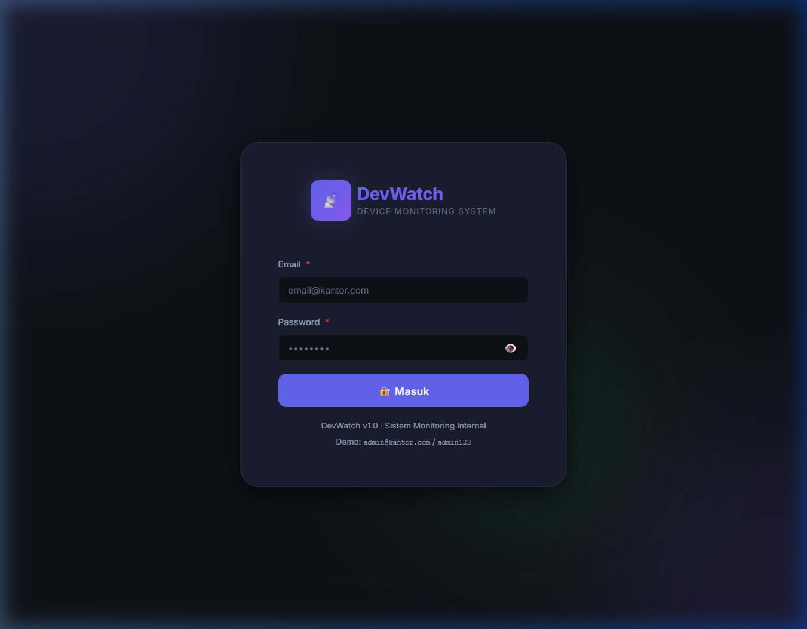
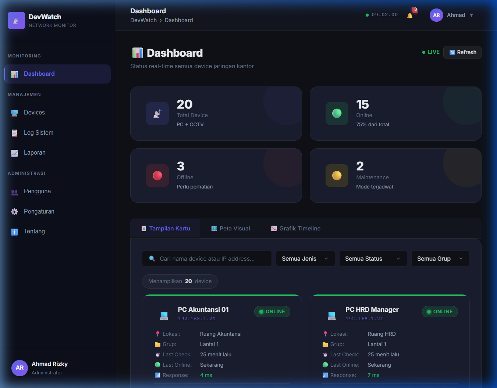
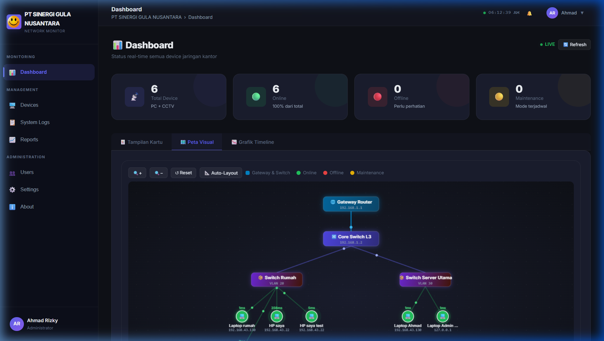
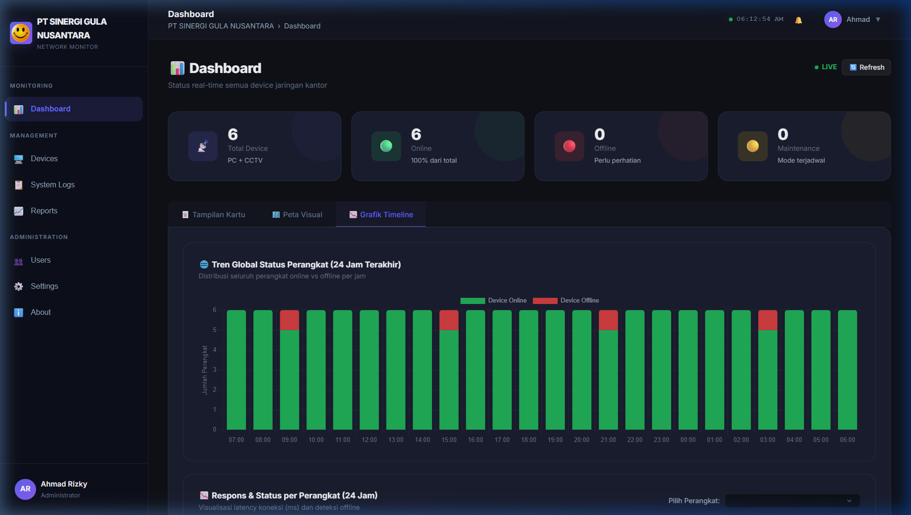
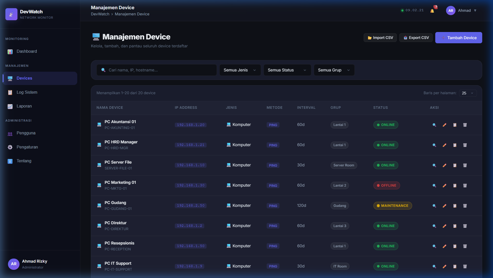
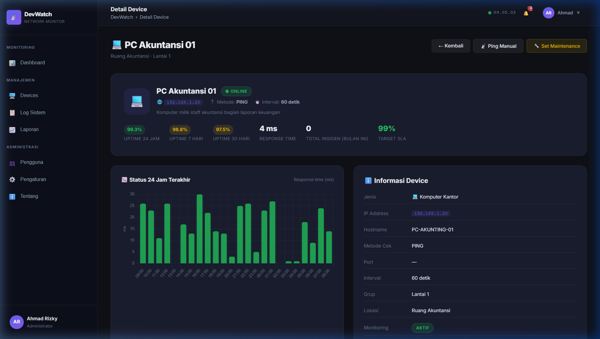
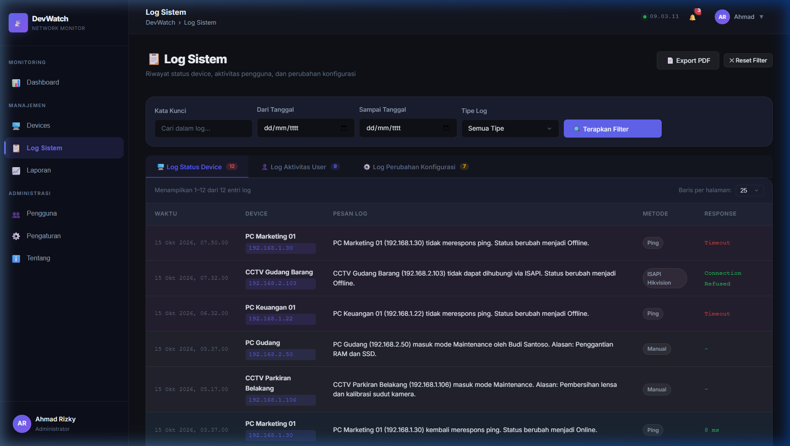
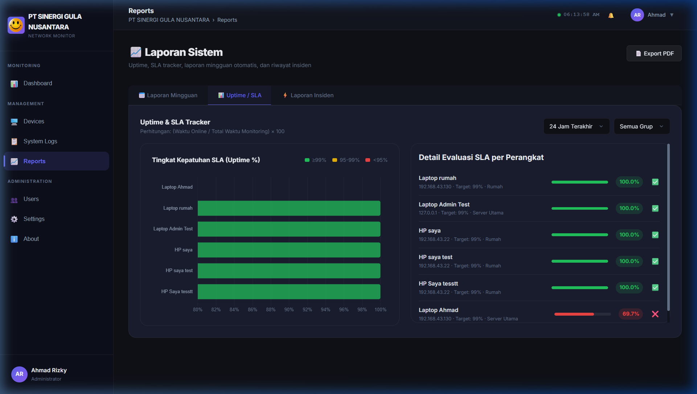
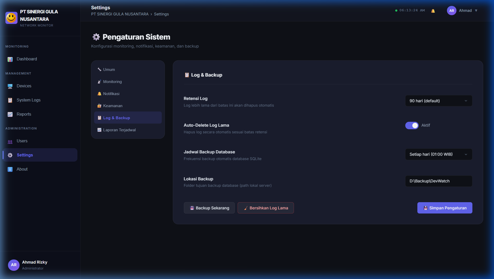
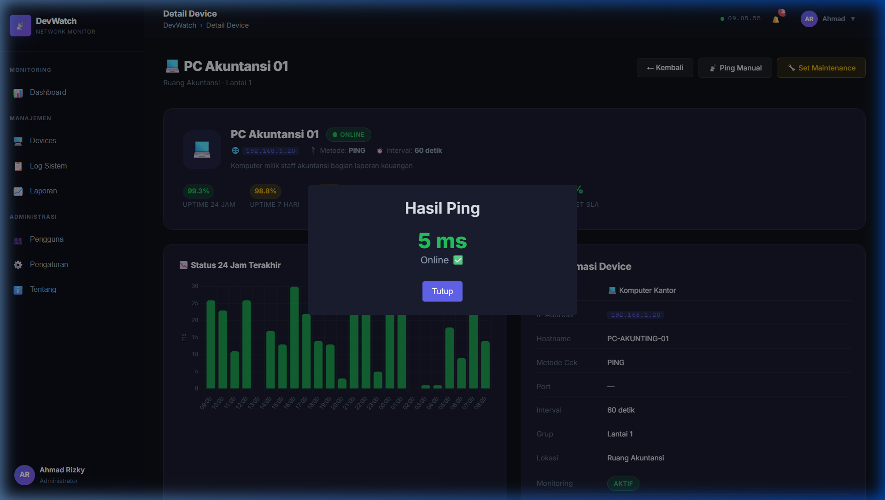

# 📡 MonDev — Sistem Monitoring Device & Jaringan

[](https://github.com)
[](#-status-pencapaian-milestone-prd)
[](https://vitejs.dev/)
[](https://developer.mozilla.org/en-US/docs/Web/JavaScript)
[](https://developer.mozilla.org/en-US/docs/Web/CSS)
[](https://sweetalert2.github.io/)
[](LICENSE)

**MonDev** adalah aplikasi web monitoring jaringan yang dirancang khusus untuk memantau status operasional perangkat kantor (seperti **Komputer/Server Kerja** dan **Kamera CCTV HIKVision**) secara langsung (*real-time*), baik di jaringan lokal (LAN) maupun jarak jauh (WAN/Internet).

Aplikasi ini mengusung antarmuka modern bertema gelap (*Dark Glassmorphism*) yang nyaman di mata, responsif di berbagai ukuran layar, serta menyajikan informasi teknis dalam bahasa Indonesia yang manusiawi dan mudah dipahami oleh siapa saja — mulai dari tim IT, teknisi lapangan, hingga staf non-teknis.

---

## 📸 Galeri Tampilan Aplikasi (Showcase)

| Halaman Login & Proteksi Keamanan | Dashboard Utama & Status Kartu |
|:---:|:---:|
|  |  |
| **Peta Topologi Hierarki Baru (Gateway ➔ Switch ➔ Device)** | **Grafik Timeline Global & Latensi 24 Jam** |
|  |  |
| **Manajemen Perangkat & Impor/Ekspor CSV** | **Detail Perangkat & Grafik Kecepatan Respons** |
|  |  |
| **Log Sistem Bahasa Manusia (3 Tab & Ekspor PDF)** | **Laporan Otomatis, SLA Tracker & Cetak PDF** |
|  |  |
| **Cadangan Basis Data SQLite & Retensi Log** | **Dialog Interaktif SweetAlert2 (Hasil Ping)** |
|  |  |

---

## 🏆 Status Pencapaian Milestone PRD (100% Complete)

Seluruh 5 fase pengembangan sesuai dokumen [PRD_Device_Monitoring.md](PRD_Device_Monitoring.md) telah selesai dan lulus verifikasi pengujian:

| Fase Milestone | Status | Fitur & Implementasi Utama |
|---|:---:|---|
| **Fase 1 — Core Foundation** | `[x]` Selesai | Node.js, Express 5, SQLite (`node:sqlite`), Worker Ping ICMP native, Autentikasi JWT, Windows Service. |
| **Fase 2 — Fitur Utama** | `[x]` Selesai | CRUD Device, 3 Jenis Log (Status, Aktivitas, Konfigurasi), Push Notification, Mode Maintenance, Multiple Delete. |
| **Fase 3 — Protokol Lanjutan** | `[x]` Selesai | ISAPI Hikvision Digest Auth, RTSP Stream Port 554, ONVIF Probe, Import Massal CSV & Download Template. |
| **Fase 4 — Laporan & Analytics** | `[x]` Selesai | Evaluasi Uptime/SLA Tracker riil, Snapshot Mingguan Otomatis, Ekspor Laporan Resmi PDF, Timeline 24 Jam. |
| **Fase 5 — Polish & Pengujian** | `[x]` Selesai | Peta Topologi Hierarki Canvas, Backup Database WAL & Download `.sqlite`, Vacuum Log, Uji Beban 250 Perangkat, Dual-Mode HTTPS (Native + Caddy/Nginx). |

> 📘 **Buku Panduan Operasional Lengkap:** Silakan pelajari [DOKUMENTASI_PENGGUNAAN.md](DOKUMENTASI_PENGGUNAAN.md) untuk panduan operasional IT harian, SOP perbaikan, dan pemeliharaan server.

---

## 📑 Daftar Isi

1. [🏆 Status Pencapaian Milestone PRD](#-status-pencapaian-milestone-prd-100-complete)
2. [✨ Sekilas Tentang DevWatch](#-sekilas-tentang-devwatch)
3. [🔄 Alur Kerja Sistem (System Workflows)](#-alur-kerja-sistem-system-workflows)
   - [Alur Deteksi & Siklus Pemantauan Status](#1-alur-deteksi--siklus-pemantauan-status)
   - [Alur Siklus Hidup Mode Pemeliharaan (Maintenance Lifecycle)](#2-alur-siklus-hidup-mode-pemeliharaan-maintenance-lifecycle)
   - [Alur Manajemen & Penambahan Perangkat Baru](#3-alur-manajemen--penambahan-perangkat-baru)
   - [Alur Audit & Penelusuran Log Insiden](#4-alur-audit--penelusuran-log-insiden)
3. [🚀 Fitur-Fitur Utama](#-fitur-fitur-utama)
4. [💻 Kebutuhan Sistem & Prasyarat](#-kebutuhan-sistem--prasyarat)
5. [🛠️ Panduan Instalasi & Menjalankan](#️-panduan-instalasi--menjalankan)
6. [🔐 Akun Demo & Hak Akses (RBAC)](#-akun-demo--hak-akses-rbac)
7. [📖 Panduan Penggunaan Halaman demi Halaman & Gambar Contoh](#-panduan-penggunaan-halaman-demi-halaman--gambar-contoh)
   - [1. Halaman Login](#1-halaman-login)
   - [2. Dashboard Utama & 3 Mode Pandang](#2-dashboard-utama--3-mode-pandang)
   - [3. Peta Topologi Jaringan (Visual Canvas Map)](#3-peta-topologi-jaringan-visual-canvas-map)
   - [4. Manajemen Device (CRUD & CSV)](#4-manajemen-device-crud--csv)
   - [5. Detail Perangkat & Uptime Chart](#5-detail-perangkat--uptime-chart)
   - [6. Uji Ping Instan & SweetAlert2 Modals](#6-uji-ping-instan--sweetalert2-modals)
   - [7. Log Sistem Berbahasa Manusia](#7-log-sistem-berbahasa-manusia)
   - [8. Laporan Uptime & Evaluasi SLA](#8-laporan-uptime--evaluasi-sla)
   - [9. Pengaturan Sistem Terpadu (6 Kategori)](#9-pengaturan-sistem-terpadu-6-kategori)
8. [🏗️ Arsitektur & Struktur Folder](#️-arsitektur--struktur-folder)
9. [🔌 Panduan Integrasi ke Backend Nyata (API)](#-panduan-integrasi-ke-backend-nyata-api)
10. [⚙️ Kustomisasi & Konfigurasi Lanjutan](#️-kustomisasi--konfigurasi-lanjutan)
11. [❓ Pertanyaan Umum & Pemecahan Masalah (FAQ)](#-pertanyaan-umum--pemecahan-masalah-faq)
12. [📄 Lisensi & Kontributor](#-lisensi--kontributor)

---

## ✨ Sekilas Tentang DevWatch

Mengapa DevWatch dibuat?

- **Mudah Dimengerti**: Menghilangkan kode galat jaringan yang ambigu. Ketika ada masalah, sistem langsung memberikan penjelasan: *"PC Akuntansi 01 di Lantai 1 tidak merespons ping sejak pukul 07:50 (Status Offline)"*.
- **Tanpa Framework Berat**: Dibangun menggunakan murni **HTML5 + CSS3 kustom + Vanilla JavaScript ES6+**, dibundel dengan **Vite**. Menghasilkan waktu muat super cepat tanpa beban runtime berlebih.
- **Visual Menawan**: Tampilan *Dark Theme* futuristik dengan ornamen neon violet, indikator status berdenyut (*pulse animation*), dan diagram interaktif.
- **Semua Dialog dengan SweetAlert2**: Semua konfirmasi, formulir cepat, peringatan bahaya, dan notifikasi sukses menggunakan modal interaktif modern yang seragam.

---

## 🔄 Alur Kerja Sistem (System Workflows)

Bagian ini menguraikan bagaimana DevWatch memproses data di balik layar dan bagaimana pengguna berinteraksi dengan aplikasi secara terstruktur.

### 1. Alur Deteksi & Siklus Pemantauan Status

Pemantauan perangkat berjalan secara periodik berdasarkan interval yang ditentukan (misal: tiap 30 detik atau 60 detik):

```
┌─────────────────┐     Ping / HTTP / RTSP      ┌─────────────────────┐
│  Mesin Worker   │ ──────────────────────────> │ Perangkat Target    │
│  DevWatch Engine│                             │ (PC Kantor / CCTV)  │
└────────┬────────┘ <────────────────────────── └─────────────────────┘
         │               Respons / Timeout
         ▼
 ┌───────────────┐
 │ Berhasil?     │
 └───┬───────┬───┘
     │ Ya    │ Tidak
     │       ▼
     │  ┌───────────────────────┐
     │  │ Uji Toleransi Gagal   │
     │  │ (3x berturut-turut?)  │
     │  └───┬───────────────┬───┘
     │      │ Belum         │ Ya, terkonfirmasi
     │      ▼               ▼
     │  [Warning]    [Status: OFFLINE (Merah)]
     │                      │
     ▼                      ├─> Buat Catatan di "Log Status"
[Status: ONLINE (Hijau)]    ├─> Nyalakan Animasi Pulse Merah di Dashboard
     │                      └─> Kirim Sinyal Notifikasi (Telegram/WA/Email)
     └─> Perbarui Response Time (ms) & Waktu Terakhir Terlihat
```

**Penjelasan Langkah:**
1. **Pengecekan Rutin**: Sistem mengirim paket deteksi ke IP sasaran sesuai metode terpilih (ICMP Ping untuk komputer, RTSP/ISAPI untuk CCTV).
2. **Evaluasi Ambang Batas (Debounce)**: Kegagalan sesaat tidak langsung membunyikan alarm; sistem menunggu 3 kali kegagalan berturut-turut untuk menghindari alarm palsu (*false positive*) akibat lonjakan trafik sesaat.
3. **Pembaruan Visual Real-Time**: Status pada kartu dan peta topologi seketika berubah warna (Hijau = Normal, Merah = Offline).
4. **Pencatatan Audit**: Setiap perpindahan status otomatis masuk ke tabel log dalam format kalimat deskriptif.

---

### 2. Alur Siklus Hidup Mode Pemeliharaan (Maintenance Lifecycle)

Mode ini mencegah alarm palsu ketika perangkat sedang dirawat, di-upgrade, atau dipindahkan fisiknya:

```
[Perangkat Normal: Online]
         │
         │ (Teknisi klik tombol "🔧 Set Maintenance")
         ▼
[Dialog SweetAlert2 Terbuka]
         │ ──> Masukkan Alasan: "Upgrade RAM & SSD"
         │ ──> Tentukan Estimasi Selesai (cth: 2 Jam)
         ▼
[Status: MAINTENANCE (Kuning Ambar)]
         ├─> Alarm & Notifikasi Offline Dinonaktifkan
         ├─> Timer Hitung Mundur Aktif di Kartu Perangkat
         └─> Riwayat Dicatat di Log Aktivitas User
         │
         ├─── Waktu Habis? ──────────────> [Notifikasi: Sesi Maintenance Berakhir]
         │                                              │
         └─── Selesai Lebih Cepat? ─────────────────────┘
                     │ (Klik "Selesai Maintenance")
                     ▼
      [Kembali ke Siklus Monitoring Normal (Online)]
```

---

### 3. Alur Manajemen & Penambahan Perangkat Baru

```
Teknisi / Admin Masuk Menu "Manajemen Device"
         │
         ├─> Klik "+ Tambah Device"
         │         │
         │         ▼
         │   [Isi Formulir Lengkap: Nama, IP, Jenis, Port, Interval]
         │         │
         │         ├─> Klik "Tes Koneksi Sekarang" (Verifikasi IP sebelum simpan)
         │         ▼
         │   [Klik Simpan] ──> Validasi Form ──> Sukses (SweetAlert Toast)
         │
         └─> OPSI MASSAL: "Impor CSV"
                   │
                   ▼
             [Pilih Berkas CSV] ──> Preview Data Tabel ──> Konfirmasi Masuk
```

---

### 4. Alur Audit & Penelusuran Log Insiden

```
Terjadi Gangguan Jaringan / Laporan CCTV Padam
         │
         ▼
Buka Halaman "Log Sistem"
         │
         ├─> Pilih Tab: "Log Status Device"
         ├─> Filter Rentang Waktu: misal "Hari Ini"
         └─> Masukkan Kata Kunci: "Gudang" atau "192.168.2."
         │
         ▼
Daftar Log Terfilter Menampilkan Kronologi Lengkap:
  • "Pukul 07:32 — CCTV Gudang Barang tidak dapat dihubungi via ISAPI. Status berubah menjadi Offline."
  • "Pukul 08:15 — CCTV Gudang Barang kembali normal setelah penanganan teknisi (Padam 43 menit)."
         │
         ▼
Klik Tombol "Export PDF" untuk Lampiran Laporan Resmi
```

---

## 🚀 Fitur-Fitur Utama

### 1. 📊 Monitoring Status Real-Time
- **Status Otomatis**: Mendeteksi status **Online** (Hijau), **Offline** (Merah), dan **Maintenance** (Kuning).
- **Multi-Metode Pengecekan**: Mendukung protokol ICMP Ping, HTTP/HTTPS Web Service, dan RTSP Stream Check (khusus CCTV HIKVision).
- **Statistik Cepat**: Kartu ringkasan total perangkat, persentase kesehatan sistem, dan jumlah perangkat yang butuh perhatian.

### 2. 🗺️ 3 Mode Pandang di Dashboard
- **Kartu Interaktif (Device Cards)**: Kartu tiap perangkat dengan tombol aksi instan (Ping manual, set maintenance, lihat detail).
- **Peta Jaringan Visual (Visual Canvas Map)**: Visualisasi graf node interaktif berbasis HTML5 Canvas. Dapat digeser (*drag-pan*) dan diperbesar/perkecil (*zoom wheel*).
- **Grafik Garis Waktu 24 Jam (Timeline Chart)**: Rekam jejak status per jam berbasis Chart.js.

### 3. 🛠️ Manajemen Perangkat Lengkap (CRUD)
- Formulir tambah perangkat baru lengkap dengan tombol **"Tes Koneksi Sekarang"**.
- Fitur **Duplikat Cepat** untuk memudahkan penambahan banyak perangkat serupa.
- **Impor & Ekspor Data CSV**: Migrasi data perangkat semudah klik tombol.

### 4. ⏱️ Mode Pemeliharaan (Maintenance Mode)
- Menandai perangkat yang sedang diservis agar tidak membunyikan alarm/notifikasi palsu.
- Hitung mundur (*countdown timer*) otomatis yang memperlihatkan sisa waktu perawatan.
- Notifikasi peringatan saat durasi pemeliharaan berakhir.

### 5. 📜 Log Aktivitas yang Fleksibel & Manusiawi
- Terbagi dalam 3 kategori jelas:
  1. **Log Status Perangkat** (kapan mati, kapan hidup kembali, berapa lama padam).
  2. **Log Aktivitas Pengguna** (siapa yang login, siapa yang mengubah pengaturan).
  3. **Log Perubahan Konfigurasi** (rekam jejak perubahan IP, interval, dan threshold).
- Filter pencarian cerdas berdasarkan tanggal, jenis log, nama perangkat, atau teks bebas.
- Tombol **Ekspor PDF** untuk arsip dan rapat audit.

### 6. 📈 Laporan Uptime & Perhitungan SLA
- Laporan mingguan dan bulanan otomatis.
- Ringkasan SLA (Service Level Agreement) dengan indikator pencapaian target (misal: 99.5%).
- Rekap insiden downtime dan rata-rata waktu perbaikan (MTTR).

### 7. 🛡️ Keamanan & Pembatasan Hak Akses (Role-Based Access)
- 3 Tingkat Akun: **Administrator**, **Teknisi**, dan **Viewer**.
- Simulasi proteksi Brute-Force: Akun terkunci otomatis selama 15 menit jika gagal login 5 kali berturut-turut.

---

## 💻 Kebutuhan Sistem & Prasyarat

Sebelum menjalankan DevWatch, pastikan komputer Anda memenuhi prasyarat berikut:

| Komponen | Kebutuhan Minimum | Kebutuhan Disarankan |
|---|---|---|
| **Sistem Operasi** | Windows 10/11, macOS 11+, Ubuntu 20.04+ | Windows 11 / Linux Server |
| **Node.js** | Versi 18.0.0 atau lebih baru | Node.js LTS (v20.x atau v22.x) |
| **Paket Manajer** | `npm` v9+ (bawaan Node.js) | `npm` v10+ atau `pnpm` |
| **Peramban (Browser)** | Google Chrome 90+, Microsoft Edge 90+, Firefox 90+, Safari 14+ | Google Chrome versi terbaru |
| **Koneksi Jaringan** | Port `5173` (development) terbuka | Port lokal standar |

> [!TIP]
> Untuk memeriksa apakah Node.js dan npm sudah terpasang di komputer Anda, buka Terminal atau Command Prompt (PowerShell) lalu ketik:
> ```bash
> node -v
> npm -v
> ```

---

## 🛠️ Panduan Instalasi & Menjalankan

Ikuti langkah mudah berikut untuk menjalankan DevWatch di komputer Anda:

### Langkah 1: Masuk ke Folder Proyek
Buka terminal (PowerShell di Windows, atau Terminal di Linux/macOS) dan arahkan ke lokasi folder:
```bash
cd d:\Projek\WEB\Monitoring-Devices
```

### Langkah 2: Siapkan File Konfigurasi Lingkungan (`.env`)
Salin berkas template `.env-example` menjadi `.env`:
```bash
# Windows PowerShell:
Copy-Item .env-example .env

# Linux / macOS:
cp .env-example .env
```
*Anda dapat menyesuaikan port, JWT secret, dan parameter timeout di dalam file `.env` jika diperlukan.*

### Langkah 3: Pasang Dependensi
Jalankan perintah ini untuk mengunduh modul pustaka yang dibutuhkan:
```bash
npm install
```

### Langkah 4: Inisialisasi Basis Data & Data Awal
Jalankan seeder untuk mengisi 20 perangkat awal, akun pengguna, dan riwayat log:
```bash
npm run seed
```

### Langkah 5: Jalankan Aplikasi
Pilih mode eksekusi yang diinginkan:

#### Opsi A: Mode Produksi Mandiri (Fullstack Terintegrasi)
```bash
npm run build
npm start
```
Aplikasi langsung aktif dan siap diakses di: **`http://localhost:3000`**

#### Opsi B: Mode Pengembangan (Vite HMR Live-Reload)
```bash
# Terminal 1: Backend Server (Port 3000)
npm run server

# Terminal 2: Frontend Vite Dev Server (Port 5173)
npm run dev
```
Akses di: **`http://localhost:5173`** (panggilan API & WebSocket otomatis diteruskan ke backend).

---

### Daftar Perintah NPM Lengkap

| Perintah | Fungsi | Keterangan |
|---|---|---|
| `npm start` | Menjalankan server produksi | Menyajikan frontend statis & backend terintegrasi di port 3000 |
| `npm run dev` | Menjalankan Vite dev server | Hot Module Replacement (HMR) untuk pengembangan antarmuka |
| `npm run build` | Membuat bundel produksi | Mengompilasi kode frontend ke folder `dist/` |
| `npm run server` | Menjalankan backend saja | Express server + WebSocket worker di port 3000 |
| `npm run seed` | Reset basis data SQLite | Mengisi ulang 20 perangkat demo dan akun bawaan |
| `npm run test:load` | **Uji Beban (Load Test)** | Menguji performa konkurensi 250 perangkat & latensi SQLite |
| `npm run cert:generate` | **Generator Sertifikat TLS** | Membuat sertifikat self-signed lokal (`ssl/server.key` & `ssl/server.crt`) |
| `npm run service:install` | **Pasang Windows Service** | Mendaftarkan DevWatch sebagai background service otomatis di Windows |
| `npm run service:uninstall` | **Hapus Windows Service** | Menghapus background service dari Windows Services |

---

## 🔐 Akun Pengguna & Hak Akses (RBAC)

Sistem telah dilengkapi dengan 3 akun bawaan yang siap digunakan untuk menguji fungsionalitas dan perbedaan hak akses:

```
┌─────────────────────────────────────────────────────────────────────────────┐
│                       DAFTAR AKUN PENGGUNA DEVWATCH                         │
├───────────────────┬──────────────────────────┬─────────────┬────────────────┤
│ PERAN (ROLE)      │ EMAIL                    │ PASSWORD    │ HAK AKSES      │
├───────────────────┼──────────────────────────┼─────────────┼────────────────┤
│ 👑 Administrator  │ admin@devwatch.local     │ admin123    │ Penuh (Semua)  │
│ 🔧 Teknisi        │ teknisi@devwatch.local   │ teknisi123  │ Kelola Perangkat│
│ 👁️ Viewer         │ viewer@devwatch.local    │ viewer123   │ Hanya Baca     │
└───────────────────┴──────────────────────────┴─────────────┴────────────────┘
```

---

## 📖 Panduan Penggunaan Halaman demi Halaman & Gambar Contoh

Berikut rincian lengkap setiap halaman aplikasi disertai tangkapan layar asli saat sistem beroperasi:

### 1. Halaman Login


- **Fungsi Utama**: Titik awal otentikasi aman bagi seluruh staf dan administrator.
- **Fitur Unggulan**:
  - Tombol lihat kata sandi (ikon mata 👁️).
  - Teks petunjuk akun demo di bagian bawah form untuk pengujian cepat tanpa menghafal akun.
  - **Proteksi Brute-Force**: Jika ada percobaan masuk yang salah hingga 5 kali berturut-turut, formulir dinonaktifkan dan jendela peringatan SweetAlert2 muncul mengunci sistem selama 15 menit.
- **Alur Penggunaan**: Masukkan email dan password $\rightarrow$ Tekan tombol **🔐 Masuk** $\rightarrow$ Sesi disimpan ke penyimpanan lokal dan pengguna diarahkan ke Dashboard.

---

### 2. Dashboard Utama & 3 Mode Pandang


- **Fungsi Utama**: Menyajikan ikhtisar komprehensif kesehatan seluruh infrastruktur kantor dalam satu layar.
- **Elemen Antarmuka**:
  - **4 Kartu Metrik Utama**:
    1. *Total Perangkat*: Menghitung seluruh komputer dan kamera terdata.
    2. *Online*: Indikator hijau menandakan perangkat merespons normal.
    3. *Offline*: Indikator merah menandakan perangkat butuh pengecekan segera.
    4. *Maintenance*: Indikator kuning menandakan jadwal perbaikan terencana.
  - **Filter Instan & Pencarian**: Kotak pencarian live yang menyaring berdasarkan nama atau alamat IP, serta pemilih dropdown untuk Jenis (Komputer/CCTV), Status, dan Lokasi.
  - **Kartu Perangkat Interaktif**: Setiap kartu memiliki denyut neon status, nama perangkat, IP, lokasi fisik, waktu respon (ms), dan 3 tombol aksi langsung (*Detail, Ping, Maintenance*).

---

### 3. Peta Topologi Jaringan (Visual Canvas Map)


- **Fungsi Utama**: Visualisasi tata letak arsitektur koneksi jaringan dari Gateway dan Core Switch ke seluruh switch grup dan komputer kerja/kamera CCTV.
- **Fitur Interaktif Canvas**:
  - **Hierarki Jaringan Jelas**:
    - 🌐 **Gateway Router (`192.168.1.1`)**: Gerbang utama koneksi WAN.
    - 🔀 **Core Switch L3 (`192.168.1.2`)**: Switch tulang punggung utama kantor.
    - 📦 **Switch Distribusi Grup**: Switch per lokasi/divisi (Server, CCTV, Office).
    - 💻 / 📷 **End Devices**: Komputer staf dan kamera pengawas.
  - **Animasi Partikel Paket Data**: Jalur kabel online memancarkan animasi partikel data bergerak (*flowing packet beads*), serta cincin aura berdenyut (*pulsing aura*) pada perangkat yang aktif.
  - **Drag & Drop Bebas**: Geser sembarang node perangkat di kanvas untuk menyesuaikan posisi dengan denah ruangan nyata. Posisi tersimpan otomatis.
  - **Tombol 📐 Auto-Layout**: Menyusun kembali seluruh struktur jaringan ke hierarki yang rapi hanya dengan satu klik.
  - **Zoom & Pan**: Kendali kanvas halus via scroll mouse atau tombol zoom toolbar.
  - **Hover Tooltip & Quick Action Modal**: Arahkan kursor untuk melihat HUD ringkasan (IP, latency ms, status) dan klik node untuk memicu aksi cepat: **📡 Probe**, **🔧 Maintenance**, atau **🔍 Detail Perangkat**.

---

### 4. Manajemen Device (CRUD & CSV)


- **Fungsi Utama**: Pusat kendali seluruh inventaris perangkat jaringan kantor.
- **Fitur Utama**:
  - **Tabel Responsif**: Menampilkan Nama, IP Address, Jenis, Protokol Metode, Interval Cek, Grup Lokasi, dan Status.
  - **Tombol Tambah Device**: Membuka modal formulir pendaftaran perangkat baru lengkap dengan opsi tes ping sebelum disimpan.
  - **Multiple Select & Hapus Massal**: Tandai beberapa perangkat via checkbox untuk dihapus secara massal dalam satu konfirmasi.
  - **Aksi Cepat di Baris**:
    - 🔍 *Lihat Rincian*: Masuk ke halaman spesifikasi perangkat.
    - ✏️ *Edit*: Mengubah nama, IP, atau interval pengecekan.
    - 📋 *Duplikat*: Menyalin data perangkat untuk registrasi cepat komputer kembar di ruangan yang sama.
    - 🗑️ *Hapus*: Menghapus perangkat dengan konfirmasi dialog SweetAlert2 merah.
  - **Impor & Ekspor CSV**: Memudahkan migrasi basis data dan pencadangan massal dilengkapi tombol **Unduh Template CSV**.

---

### 5. Detail Perangkat & Uptime Chart


- **Fungsi Utama**: Investigasi mendalam performa dan kestabilan sebuah mesin atau kamera.
- **Informasi yang Ditampilkan**:
  - Kartu ringkasan SLA: Persentase uptime 24 jam, 7 hari, dan 30 hari terakhir.
  - **Grafik Bar Responsivitas 24 Jam**: Memperlihatkan grafik latensi (ms) per jam untuk mendeteksi jam sibuk (*network congestion*).
  - **Tabel Spesifikasi Teknis**: Hostname, jenis perangkat, MAC Address, metode cek, port komunikasi, dan subnet.
  - **Riwayat Insiden Downtime**: Kapan terakhir kali perangkat padam, penyebabnya, dan durasi perbaikan.

---

### 6. Uji Ping Instan & SweetAlert2 Modals


- **Fungsi Utama**: Menghubungi perangkat secara on-demand tanpa perlu menunggu jadwal polling otomatis.
- **Pengalaman Pengguna**:
  - Saat tombol 📡 **Ping** diklik, spinner animasi mikro berputar menandakan request sedang dikirim ke backend ICMP / ISAPI.
  - Hasil respons ditampilkan secara elegan via dialog modal **SweetAlert2**:
    - **Berhasil (Hijau)**: Menampilkan latensi aktual (ms) dan detail byte respons.
    - **Gagal (Merah)**: Menampilkan keterangan galat (Timeout / Destination Host Unreachable / Device Offline).
    - **Dialog Konfirmasi Hapus**: Perlindungan ekstra bertingkat untuk mencegah penghapusan perangkat secara tidak sengaja.

---

### 7. Log Sistem & Audit Trail


- **Fungsi Utama**: Rekaman kronologis seluruh kejadian jaringan dan aktivitas staf IT.
- **Fitur 3 Tab Log**:
  1. **Log Status**: Perubahan kondisi perangkat (Online / Offline / Maintenance) lengkap dengan durasi latency ms dan penyebab.
  2. **Log Aktivitas**: Riwayat tindakan staf (Login, Ping manual, Ekspor data, Ekspor PDF).
  3. **Log Konfigurasi**: Pencatatan audit saat ada penambahan, pengubahan, atau penghapusan perangkat.
- **Alat Pencarian**:
  - Filter berdasarkan rentang tanggal kalender.
  - Dropdown filter jenis log & tingkat severitas (INFO, WARNING, ERROR).
  - Kolom pencarian teks instan untuk memfilter hostname atau IP tertentu.

---

### 8. Laporan Uptime, Evaluasi SLA & Ekspor PDF


- **Fungsi Utama**: Evaluasi kepatuhan tingkat layanan (Service Level Agreement) dan penyusunan laporan operasional manajemen IT.
- **Metrik SLA Eksekutif**:
  - Kartu indikator pemenuhan SLA 24 jam, 7 hari, dan 30 hari dengan target standar 99.5%.
  - **Grafik Tren Uptime & Downtime**: Visualisasi rasio ketersediaan sistem sepanjang waktu.
  - **Daftar Perangkat Performa Terendah (Top 5 Down)**: Peringatan dini perangkat yang paling sering mengalami gangguan.
  - **Rekapitulasi Insiden**: Daftar seluruh pemadaman jaringan lengkap dengan waktu henti, waktu pemulihan, durasi, dan catatan penyebab.
  - **Unduh Laporan PDF Resmi**: Menghasilkan dokumen PDF korporat berkelas eksekutif lengkap dengan kop instansi, rekap skor SLA, tabel insiden, dan kolom pengesahan tanda tangan.
  - **Ekspor CSV**: Mengunduh data mentah riwayat insiden untuk kebutuhan analisis eksternal di Excel.

---

### 9. Pengaturan Sistem, Cadangan Basis Data & Retensi


- **Fungsi Utama**: Pusat konfigurasi parameter aplikasi dan pemeliharaan basis data:
  1. **Umum**: Nama instansi, upload logo perusahaan (Base64), zona waktu nasional (WIB/WITA/WIT), dan bahasa antarmuka.
  2. **Monitoring**: Batas toleransi Ping Timeout (ms), batas kegagalan sebelum dinyatakan offline (default: 3x), port standar RTSP (554).
  3. **Notifikasi**: Tombol uji push notification browser, penanda dibaca, dan pembersihan riwayat notifikasi.
  4. **Keamanan**: Durasi kedaluwarsa sesi JWT, ambang batas proteksi brute force login.
  5. **Sistem & Basis Data**:
     - **Cadangkan Database Sekarang**: Mengeksekusi checkpoint WAL SQLite (`PRAGMA wal_checkpoint(TRUNCATE)`) dan membuat salinan timestamped di `data/backups/`.
     - **Unduh Berkas SQLite**: Mengunduh file `.sqlite` cadangan secara instan dari browser.
     - **Bersihkan Log Lama**: Menghapus catatan riwayat melebihi batas retensi dan menjalankan `PRAGMA incremental_vacuum` untuk mengompresi ukuran disk basis data.

---

## 🏗️ Arsitektur & Struktur Folder

Proyek DevWatch dirancang dengan pola modular berbasis komponen murni tanpa keterikatan pada pustaka pihak ketiga yang rumit:

```text
Monitoring-Devices/
├── .env-example                 # Template konfigurasi variabel lingkungan (.env)
├── DOKUMENTASI_PENGGUNAAN.md    # Buku panduan operasional IT & SOP lengkap (12 Bab)
├── PANDUAN_BUILD_DAN_DEPLOY_PRODUKSI.md # Buku panduan build & deployment server produksi lengkap
├── PRD_Device_Monitoring.md     # Dokumen Persyaratan Produk (PRD) referensi Fase 1–5
├── README.md                    # Dokumentasi utama aplikasi (berkas ini)
├── index.html                   # Shell HTML utama & kontainer aplikasi SPA
├── package.json                 # Konfigurasi dependensi dan skrip proyek
├── vite.config.js               # Konfigurasi bundler Vite + reverse proxy ke Express
│
├── data/                        # Penyimpanan Database SQLite
│   ├── .gitkeep
│   ├── devwatch.db              # Database SQLite persisten (Node built-in DatabaseSync)
│   └── backups/                 # Arsip snapshot cadangan database timestamped (.sqlite)
│
├── deployment/                  # Konfigurasi Reverse Proxy Produksi
│   ├── Caddyfile                # Reverse proxy Caddy 2 (Automatic HTTPS Let's Encrypt)
│   └── nginx.conf               # Reverse proxy Nginx (HTTP/2 + WebSocket)
│
├── ssl/                         # Direktori Sertifikat TLS/HTTPS Mandiri
│   ├── .gitkeep
│   ├── server.key               # Kunci privat TLS (dihasilkan via npm run cert:generate)
│   └── server.crt               # Sertifikat X.509
│
├── server/                      # Backend Express & Worker Engine
│   ├── index.js                 # Entry point Express, Dual-Mode HTTPS, WebSocket, static fallback
│   ├── config.js                # Konfigurasi port, JWT, database, timeout, dan path SSL
│   ├── database/
│   │   ├── schema.sql           # Skema DDL 8 tabel (users, devices, logs, incidents, settings, dll)
│   │   ├── db.js                # Wrapper koneksi synchronous SQLite Node 24 (WAL mode)
│   │   └── seed.js              # Seeder data pengguna default, 20 perangkat awal, dan riwayat log
│   ├── middleware/
│   │   ├── auth.js              # JWT authentication & Role-Based Access Control (RBAC)
│   │   ├── rateLimiter.js       # Proteksi brute-force login (lockout 15 menit jika 5x gagal)
│   │   └── errorHandler.js      # Penanganan galat global Express
│   ├── services/
│   │   ├── pingService.js       # Native ICMP ping runner (Windows ping.exe)
│   │   ├── hikvisionService.js  # Probe ISAPI HTTP & RTSP probe untuk CCTV Hikvision
│   │   ├── websocketService.js  # Broadcast real-time status change dan telemetry
│   │   ├── monitoringWorker.js  # Background loop polling, debounce 3x gagal, insiden tracker
│   │   └── reportService.js     # Generator laporan mingguan, SLA bulanan, dan audit
│   ├── routes/
│   │   ├── auth.js              # Endpoint login, profil /me, logout
│   │   ├── devices.js           # CRUD perangkat, ping instan, maintenance, impor CSV, info ISAPI
│   │   ├── logs.js              # Query & filter log sistem (3 tab)
│   │   ├── reports.js           # Laporan mingguan, SLA tracker, insiden
│   │   ├── users.js             # Administrasi pengguna & reset kata sandi (Admin Only)
│   │   └── settings.js          # Pengaturan sistem, backup database, dan vacuum log
│   └── scripts/
│       ├── load-test.js         # Pengujian beban & stress testing 250 perangkat concurrent
│       ├── generate-cert.js     # Generator sertifikat TLS lokal self-signed (RSA 2048-bit)
│       ├── install-service.js   # Pemasang Background Windows Service
│       └── uninstall-service.js # Pencabut Windows Service
│
├── src/                         # Frontend Vanilla JS Single Page Application
│   ├── main.js                  # Entry point SPA, inisialisasi sesi & router
│   ├── router.js                # Hash SPA Router dengan proteksi autentikasi & peran
│   ├── api.js                   # Client HTTP terpusat (Bearer JWT) & WebSocket listener
│   ├── styles/                  # Modul Tata Gaya (CSS Murni Modern Dark Glassmorphism)
│   ├── components/              # Komponen sidebar, topbar, device-card, grafik Chart.js
│   ├── data/                    # State perangkat, sinkronisasi otomatis dengan backend
│   ├── pages/                   # Kontroler halaman (login, dashboard, devices, logs, reports, users, settings, about)
│   └── services/                # Ekspor PDF resmi (jsPDF) & notifikasi peramban
└── images/                      # Tangkapan layar galeri dokumentasi
```

---

## 🖥️ Backend Terpadu & Windows Service (Siap Produksi)

DevWatch telah dilengkapi dengan **backend mandiri** yang terintegrasi secara penuh dengan antarmuka frontend, mengusung arsitektur ringan tanpa ketergantungan pustaka C++ eksternal:

### 1. Spesifikasi Teknis Backend
- **Runtime**: Node.js v24 LTS (menggunakan modul bawaan `node:sqlite` / `DatabaseSync` yang cepat dan stabil tanpa perlu kompilasi `node-gyp`).
- **Web Framework**: Express.js 5 dengan middleware keamanan (Helmet, CORS, JWT Bearer Token, Rate Limiting).
- **Komunikasi Real-Time**: WebSocket murni (`ws`) di endpoint `/ws` untuk menyiarkan perubahan status perangkat secara instan ke browser tanpa perlu me-refresh halaman.
- **Engine Probe Jaringan Nyata**:
  - **PC / Server**: Menjalankan native ICMP Ping langsung via OS Windows `ping.exe` (mengukur latensi ms sesungguhnya).
  - **CCTV HIKVision**: Menjalankan probe HTTP ISAPI digest challenge dan RTSP TCP port check dengan fallback ICMP.
  - **Anti-Flapping (Debounce)**: Status baru dinyatakan **OFFLINE** jika gagal 3 kali berturut-turut untuk menghindari alarm palsu akibat jitter jaringan sesaat.

### 2. Cara Menjalankan Aplikasi

#### A. Mode Produksi Mandiri (Standalone Fullstack)
Cukup jalankan satu perintah berikut:
```bash
npm start
```
Server backend Express akan aktif di **`http://localhost:3000`** dan secara otomatis menyajikan antarmuka web yang sudah dibundel beserta seluruh API dan WebSocket secara bersamaan.

#### B. Mode Pengembangan (Development Live-Reload)
Jika Anda ingin mengubah kode frontend dengan Vite HMR:
```bash
# Terminal 1: Jalankan Backend Express (Port 3000)
npm run server

# Terminal 2: Jalankan Frontend Vite Dev Server (Port 5173)
npm run dev
```
Vite telah dikonfigurasi dengan reverse proxy otomatis: seluruh panggilan `/api/*` dan `/ws` dari browser di port `5173` akan diteruskan ke backend Express di port `3000`.

#### C. Reset / Seed Ulang Database
Untuk mengisi kembali 20 perangkat demo, akun pengguna, dan riwayat log bawaan:
```bash
npm run seed
```

#### D. Memasang sebagai Background Windows Service
Agar DevWatch berjalan otomatis di latar belakang saat komputer atau server Windows dinyalakan tanpa perlu membuka terminal:

1. Buka **Command Prompt / PowerShell** dengan hak akses **Administrator**.
2. Jalankan perintah instalasi:
   ```bash
   npm run service:install
   ```
3. Layanan Windows bernama **"DevWatch Device Monitoring"** akan terdaftar dan berjalan otomatis (*Auto-Start on Boot*).
4. Untuk menghapus layanan Windows:
   ```bash
   npm run service:uninstall
   ```

---

### 3. Daftar Endpoint REST API

Semua endpoint dilindungi dengan header `Authorization: Bearer <token>` kecuali rute login.

| Metode | Endpoint | Hak Akses | Keterangan |
|---|---|---|---|
| `POST` | `/api/auth/login` | Publik | Autentikasi email & password, mengembalikan token JWT |
| `GET` | `/api/auth/me` | Semua Peran | Memeriksa sesi pengguna aktif |
| `POST` | `/api/auth/logout` | Semua Peran | Mengakhiri sesi pengguna |
| `GET` | `/api/devices` | Semua Peran | Daftar seluruh perangkat terdaftar (mendukung filter grup & jenis) |
| `GET` | `/api/devices/:id` | Semua Peran | Rincian lengkap 1 perangkat beserta riwayat insiden |
| `POST` | `/api/devices` | Admin / Teknisi | Mendaftarkan perangkat baru ke database |
| `PUT` | `/api/devices/:id` | Admin / Teknisi | Memperbarui parameter perangkat |
| `DELETE`| `/api/devices/:id` | Admin | Menghapus perangkat dari database |
| `POST` | `/api/devices/:id/ping` | Admin / Teknisi | Menjalankan probe ICMP / ISAPI manual saat itu juga |
| `POST` | `/api/devices/:id/maintenance` | Admin / Teknisi | Mengaktifkan / menyelesaikan mode pemeliharaan |
| `POST` | `/api/devices/import-csv` | Admin / Teknisi | Impor perangkat massal dari array CSV |
| `GET` | `/api/logs` | Semua Peran | Riwayat log (Status, Aktivitas, Konfigurasi) dengan paginasi & filter |
| `GET` | `/api/reports/weekly` | Semua Peran | Laporan ringkasan mingguan otomatis |
| `GET` | `/api/reports/sla` | Semua Peran | Evaluasi persentase pemenuhan target SLA (24j, 7h, 30h) |
| `GET` | `/api/reports/incidents`| Semua Peran | Rekapitulasi insiden downtime & durasi perbaikan |
| `GET` | `/api/users` | Admin Only | Daftar akun pengguna terdaftar |
| `POST` | `/api/users` | Admin Only | Menambah akun pengguna baru (hash password bcrypt) |
| `PUT` | `/api/users/:id` | Admin Only | Memperbarui nama, peran, atau status aktif pengguna |
| `DELETE`| `/api/users/:id` | Admin Only | Menghapus akun pengguna |
| `POST` | `/api/users/:id/reset-password` | Admin Only | Mengganti kata sandi pengguna |
| `GET` | `/api/devices/:id/isapi` | Semua Peran | Mengambil metadata perangkat CCTV Hikvision via HTTP ISAPI |
| `GET` | `/api/settings` | Admin Only | Mengambil pengaturan umum, monitoring, dan notifikasi |
| `PUT` | `/api/settings` | Admin Only | Menyimpan perubahan pengaturan sistem |
| `POST` | `/api/settings/backup` | Admin Only | Menjalankan WAL checkpoint & backup cadangan basis data |
| `GET` | `/api/settings/backup/download` | Admin Only | Mengunduh berkas fisik snapshot cadangan `.sqlite` |
| `POST` | `/api/settings/clean-logs` | Admin Only | Pembersihan log melampaui retensi & disk vacuum |

---

### 4. Panduan Deployment Produksi & HTTPS (Dual-Mode)

> [!TIP]
> **Panduan Server Produksi Lengkap**: Untuk tutorial langkah-demi-langkah mendalam mencakup setup Windows Server, Linux systemd, Process Manager (PM2 / NSSM), alur build, pencadangan otomatis, dan troubleshooting, silakan baca **[PANDUAN_BUILD_DAN_DEPLOY_PRODUKSI.md](PANDUAN_BUILD_DAN_DEPLOY_PRODUKSI.md)**.

DevWatch mendukung fleksibilitas deployment skala enterprise dengan dua mode enkripsi TLS/HTTPS:

#### Opsi 1: Native Node.js HTTPS (Tanpa Reverse Proxy Tambahan)
Sangat ideal untuk intranet instansi atau server Windows lokal yang memerlukan komunikasi terenkripsi langsung dari Node:
1. Buat sertifikat TLS lokal (RSA 2048-bit, masa berlaku 365 hari):
   ```bash
   npm run cert:generate
   ```
   *Sertifikat dan private key akan otomatis disimpan di `ssl/server.crt` dan `ssl/server.key`.*
2. Aktifkan konfigurasi di berkas `.env`:
   ```env
   USE_HTTPS=true
   PORT=3443
   SSL_KEY_PATH=./ssl/server.key
   SSL_CERT_PATH=./ssl/server.crt
   ```
3. Jalankan server:
   ```bash
   npm start
   ```
   Aplikasi akan melayani HTTPS & Secure WebSocket (`wss://`) di port `3443`.

#### Opsi 2: Reverse Proxy Standar Industri (Caddy & Nginx)
Tersedia konfigurasi siap pakai di direktori `deployment/`:

- **Caddy Server (`deployment/Caddyfile`)**:
  Menyediakan sertifikat SSL Let's Encrypt gratis dan terbarukan otomatis:
  ```bash
  caddy run --config deployment/Caddyfile
  ```
- **Nginx (`deployment/nginx.conf`)**:
  Konfigurasi reverse proxy HTTP/2 tangguh dengan penanganan upgrade WebSocket (`/ws`), header keamanan Helmet, dan caching statis aset frontend Vite.

#### Opsi 3: Pengujian Beban Jaringan (Stress & Load Testing)
Sebelum mengoperasikan di jaringan kantor yang sangat padat, uji performa konkurensi backend dengan skrip simulasi 250 perangkat simultan:
```bash
npm run test:load
```
*Hasil tes memvalidasi waktu respons probe, kestabilan event loop Node.js, dan kehandalan SQLite WAL tanpa kebocoran memori (leak).*

---

## ⚙️ Kustomisasi & Konfigurasi Lanjutan

### Mengubah Port Vite
Secara default, Vite berjalan di port `5173`. Jika Anda ingin mengubahnya ke port `3000` atau `8080`, edit file `vite.config.js`:

```javascript
import { defineConfig } from 'vite';

export default defineConfig({
  server: {
    port: 3000,       // Ganti dengan port yang diinginkan
    host: true        // Buka '0.0.0.0' agar bisa diakses oleh komputer lain di jaringan lokal
  }
});
```

### Menyesuaikan Tema Warna
Seluruh variabel warna didefinisikan secara rapi di file [src/styles/base.css](file:///d:/Projek/WEB/Monitoring-Devices/src/styles/base.css). Anda dapat mengubah tema warna utama sesuai identitas kantor:

```css
:root {
  /* Warna Dasar */
  --bg-primary: #0f1117;     /* Latar belakang utama */
  --bg-card: #1a1d2e;        /* Latar kartu komponen */
  --bg-sidebar: #13151f;     /* Latar menu bilah samping */

  /* Warna Indikator Status */
  --color-online: #22c55e;   /* Hijau cerah untuk Online */
  --color-offline: #ef4444;  /* Merah terang untuk Offline */
  --color-maintenance: #eab308; /* Kuning ambar untuk Perawatan */
  --color-accent: #6366f1;   /* Indigo/Ungu aksen utama */
}
```

---

## ❓ Pertanyaan Umum & Pemecahan Masalah (FAQ)

### Q1: Apakah aplikasi ini bisa dijalankan tanpa koneksi internet sama sekali (Offline LAN)?
**Jawab**: **Ya, tentu saja!** Setelah Anda menjalankan `npm install` pertama kali saat setup awal, seluruh berkas pustaka telah tersimpan secara lokal di folder `node_modules`. Anda dapat menjalankan DevWatch di jaringan intranet tertutup (air-gapped environment) tanpa kendala.

### Q2: Bagaimana cara agar aplikasi ini bisa diakses dari HP atau komputer lain di kantor?
**Jawab**:
1. Pastikan kedua perangkat terhubung ke Wi-Fi atau switch jaringan yang sama.
2. Jalankan perintah:
   ```bash
   npm run dev -- --host
   ```
3. Terminal akan menampilkan alamat IP lokal komputer Anda, misalnya: `http://192.168.1.100:5173`.
4. Buka alamat tersebut melalui browser di ponsel pintar atau laptop staf lainnya.

### Q3: Bagaimana cara menambah jenis perangkat lain selain PC dan CCTV HIKVision?
**Jawab**: Anda dapat membuka form **+ Tambah Device** di menu Devices. Masukkan nama perangkat apa saja (seperti *Router Mikrotik*, *Fingerprint Absensi*, atau *Access Point Wi-Fi*), pilih metode Ping ICMP atau HTTP Check, dan sistem akan langsung memantaunya dengan cara yang sama.

### Q4: Timbul pesan galat "Port 5173 is in use" saat menjalankan `npm run dev`?
**Jawab**: Hal ini terjadi jika ada sesi Vite lama yang belum ditutup. Vite akan secara otomatis mencari port kosong berikutnya (seperti `5174`), atau Anda dapat mematikan proses node yang sedang aktif melalui Task Manager (Windows) / `killall node` (Linux/Mac).

---

## 📄 Lisensi & Kontributor

- **Pengembang / Pembuat Projek**: **Fatur**
- **Lisensi**: Bebas digunakan dan dimodifikasi untuk keperluan internal instansi/kantor di bawah lisensi [MIT License](LICENSE).
- **Versi Rilis**: v1.0.0 (Tahun 2026)

---

*MonDev — Memastikan seluruh infrastruktur teknologi informasi kantor Anda tetap terhubung dan terpantau dengan tenang.* 🚀
