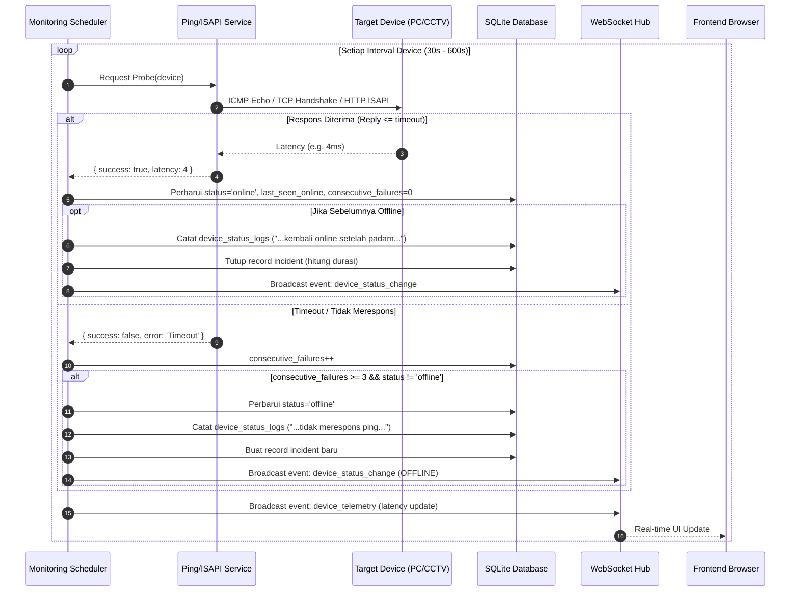

# Backend Plan — DevWatch: Sistem Monitoring Device Jaringan

## Goal

Membangun backend lengkap untuk **DevWatch** sesuai [PRD_Device_Monitoring.md](file:///d:/Projek/WEB/Monitoring-Devices/PRD_Device_Monitoring.md). Stack: **Node.js (ES Modules) + Express.js + SQLite + WebSocket (`ws`) + ICMP/ISAPI/TCP Engine**. Backend dapat berjalan sebagai development server terpisah (dengan Vite proxy) maupun sebagai **Windows Service** mandiri yang menyajikan API sekaligus build frontend produksi (`dist/`).

---

## User Review Required

> [!IMPORTANT]
> **Database Engine:** Node.js v24.15.0 yang terpasang di sistem memiliki pustaka resmi **`node:sqlite` (`DatabaseSync`)** bawaan. Menggunakan `node:sqlite` mengeliminasi kebutuhan kompilasi native C++ (`node-gyp`/Visual Studio C++ build tools) yang kerap bermasalah di Windows, sekaligus menawarkan performa sinkron secepat `better-sqlite3`.

> [!IMPORTANT]
> **Arsitektur Pemantauan:** Worker pemantauan berjalan di proses Node.js di latar belakang (background thread/timer). Setiap interval device:
> 1. Melakukan **ICMP Ping** menggunakan utilitas sistem `ping.exe` bawaan Windows (cepat, tanpa perlu akses raw socket Administrator khusus).
> 2. Untuk CCTV Hikvision: Melakukan tes koneksi HTTP/ISAPI atau handshake TCP ke port RTSP/HTTP.
> 3. Mendeteksi transisi status dengan toleransi 3x kegagalan berturut-turut (*debounce*) untuk mencegah alarm palsu.
> 4. Mencatat ke tabel `device_logs` dalam kalimat bahasa Indonesia natural.
> 5. Memancarkan pembaruan secara instan ke frontend via **WebSocket**.

> [!WARNING]
> **Windows Service:** PRD mensyaratkan instalasi sebagai Windows Service. Kami akan menyediakan script otomatis `scripts/install-service.js` dan `scripts/uninstall-service.js` menggunakan paket `node-windows`, serta panduan alternatif berbasis `nssm` (Non-Sucking Service Manager).

---

## Konfirmasi Keputusan Desain

> [!NOTE]
> **Keputusan User:**
> 1. **Metode Pemantauan:** **Mode Jaringan Nyata Murni**. Worker hanya melakukan ICMP ping fisik asli ke IP perangkat tanpa data palsu/simulasi. Status online/offline mencerminkan kondisi riil koneksi jaringan.
> 2. **Port & Distribusi:** **Port 3000** untuk Express API & WebSocket. Pada mode dev, Vite di port `5173` mem-proxy permintaan ke port `3000`. Pada mode Windows Service (produksi), Express menyajikan API sekaligus berkas frontend `dist/` secara mandiri.


---

## Proposed Changes

### 📁 Struktur Proyek Baru

```text
Monitoring-Devices/
├── server/
│   ├── config.js                 # Konfigurasi env (PORT, JWT_SECRET, DB_PATH, dll)
│   ├── index.js                  # Entry point Express + HTTP + WebSocket server
│   ├── database/
│   │   ├── db.js                 # Inisialisasi SQLite (node:sqlite), helper queries
│   │   ├── schema.sql            # Definisi tabel DDL & indeks
│   │   └── seed.js               # Data awal (Admin, Teknisi, Viewer, 20 device)
│   ├── middleware/
│   │   ├── auth.js               # JWT verification & role authorization (admin/teknisi/viewer)
│   │   ├── errorHandler.js       # Centralized error handler
│   │   └── rateLimiter.js        # Proteksi brute-force login (5x gagal -> 15 min lock)
│   ├── services/
│   │   ├── pingService.js        # ICMP Ping engine (Windows ping.exe wrapper)
│   │   ├── hikvisionService.js   # Hikvision ISAPI & RTSP port checker
│   │   ├── monitoringWorker.js   # Background scheduler polling per interval
│   │   ├── websocketService.js   # WebSocket broadcast manager (live status updates)
│   │   └── reportService.js      # Kalkulasi agregat SLA, uptime %, & insiden
│   ├── routes/
│   │   ├── auth.js               # POST /api/auth/login, GET /api/auth/me, POST /logout
│   │   ├── devices.js            # CRUD /api/devices, /:id/ping, /:id/maintenance, CSV
│   │   ├── logs.js               # GET /api/logs (3 tabs, filter, pagination, export)
│   │   ├── reports.js            # GET /api/reports/weekly, /sla, /incidents
│   │   ├── users.js              # CRUD /api/users, reset password (Admin only)
│   │   └── settings.js           # GET & PUT /api/settings (6 kategori)
│   └── scripts/
│       ├── install-service.js    # Script pasang Windows Service
│       └── uninstall-service.js  # Script copot Windows Service
│
├── src/                          # Frontend SPA yang sudah ada
│   ├── api.js                    # [NEW] REST API client & WebSocket listener
│   └── data/
│       ├── mock-devices.js       # [MODIFY] Mengambil data dari API dengan fallback
│       ├── mock-users.js         # [MODIFY] Terhubung ke API auth
│       ├── mock-logs.js          # [MODIFY] Terhubung ke API logs
│       └── mock-reports.js       # [MODIFY] Terhubung ke API reports
│
├── vite.config.js                # [MODIFY] Tambah proxy /api dan /ws ke http://localhost:3000
└── package.json                  # [MODIFY] Tambah skrip npm "server", "start", "service:install"
```

---

### 🗄️ Skema Database SQLite (`server/database/schema.sql`)

```sql
-- 1. Pengguna & Autentikasi
CREATE TABLE IF NOT EXISTS users (
  id INTEGER PRIMARY KEY AUTOINCREMENT,
  nama TEXT NOT NULL,
  email TEXT UNIQUE NOT NULL,
  password_hash TEXT NOT NULL,
  role TEXT CHECK(role IN ('admin', 'teknisi', 'viewer')) NOT NULL DEFAULT 'viewer',
  avatar TEXT,
  status TEXT CHECK(status IN ('aktif', 'nonaktif')) NOT NULL DEFAULT 'aktif',
  last_login DATETIME,
  ip_akses TEXT,
  notif_settings TEXT, -- JSON
  created_at DATETIME DEFAULT CURRENT_TIMESTAMP,
  updated_at DATETIME DEFAULT CURRENT_TIMESTAMP
);

-- 2. Daftar Perangkat Jaringan
CREATE TABLE IF NOT EXISTS devices (
  id INTEGER PRIMARY KEY AUTOINCREMENT,
  nama TEXT NOT NULL,
  ip TEXT NOT NULL,
  hostname TEXT,
  jenis TEXT CHECK(jenis IN ('Komputer', 'CCTV Hikvision')) NOT NULL,
  metode TEXT CHECK(metode IN ('PING', 'ISAPI', 'RTSP', 'ONVIF')) NOT NULL DEFAULT 'PING',
  port INTEGER,
  username TEXT,
  password_encrypted TEXT,
  interval_detik INTEGER NOT NULL DEFAULT 60,
  grup TEXT NOT NULL,
  lokasi TEXT NOT NULL,
  deskripsi TEXT,
  status TEXT CHECK(status IN ('online', 'offline', 'maintenance')) NOT NULL DEFAULT 'offline',
  last_check DATETIME,
  last_seen_online DATETIME,
  response_time_ms INTEGER DEFAULT 0,
  target_sla REAL DEFAULT 99.0,
  maintenance_reason TEXT,
  maintenance_until DATETIME,
  is_active INTEGER NOT NULL DEFAULT 1,
  consecutive_failures INTEGER NOT NULL DEFAULT 0,
  created_at DATETIME DEFAULT CURRENT_TIMESTAMP,
  updated_at DATETIME DEFAULT CURRENT_TIMESTAMP
);

-- 3. Log Status Perangkat (Kapan Mati / Hidup)
CREATE TABLE IF NOT EXISTS device_status_logs (
  id INTEGER PRIMARY KEY AUTOINCREMENT,
  device_id INTEGER NOT NULL,
  device_name TEXT NOT NULL,
  device_ip TEXT NOT NULL,
  waktu DATETIME DEFAULT CURRENT_TIMESTAMP,
  status_sebelumnya TEXT,
  status_baru TEXT NOT NULL,
  metode TEXT,
  response_time TEXT,
  pesan_log TEXT NOT NULL,
  FOREIGN KEY (device_id) REFERENCES devices(id) ON DELETE CASCADE
);

-- 4. Log Aktivitas Pengguna (Audit Trail)
CREATE TABLE IF NOT EXISTS user_activity_logs (
  id INTEGER PRIMARY KEY AUTOINCREMENT,
  user_id INTEGER,
  user_email TEXT NOT NULL,
  user_nama TEXT NOT NULL,
  waktu DATETIME DEFAULT CURRENT_TIMESTAMP,
  aksi TEXT NOT NULL,
  ip_akses TEXT,
  detail TEXT
);

-- 5. Log Perubahan Konfigurasi
CREATE TABLE IF NOT EXISTS config_logs (
  id INTEGER PRIMARY KEY AUTOINCREMENT,
  user_id INTEGER,
  user_nama TEXT NOT NULL,
  waktu DATETIME DEFAULT CURRENT_TIMESTAMP,
  aksi TEXT NOT NULL,
  device_id INTEGER,
  device_nama TEXT,
  detail TEXT NOT NULL
);

-- 6. Riwayat Insiden Downtime
CREATE TABLE IF NOT EXISTS incidents (
  id INTEGER PRIMARY KEY AUTOINCREMENT,
  device_id INTEGER NOT NULL,
  waktu_mulai DATETIME NOT NULL,
  waktu_selesai DATETIME,
  durasi_menit INTEGER DEFAULT 0,
  penyebab TEXT,
  status TEXT CHECK(status IN ('terbuka', 'selesai')) DEFAULT 'terbuka',
  FOREIGN KEY (device_id) REFERENCES devices(id) ON DELETE CASCADE
);

-- 7. Pengaturan Sistem Global
CREATE TABLE IF NOT EXISTS system_settings (
  kategori TEXT NOT NULL,
  kunci TEXT NOT NULL PRIMARY KEY,
  nilai TEXT NOT NULL,
  updated_at DATETIME DEFAULT CURRENT_TIMESTAMP
);
```

---

### 📡 Alur Monitoring Engine (`server/services/monitoringWorker.js`)



---

### 🔌 API Endpoints Detail

| Modul | Endpoint | Metode | Role Minimum | Deskripsi |
|---|---|---|---|---|
| **Auth** | `/api/auth/login` | `POST` | Public | Login email + password, rate limit 5x |
| | `/api/auth/me` | `GET` | Viewer | Info user dari token JWT |
| | `/api/auth/logout` | `POST` | Viewer | Invalidate sesi & catat activity log |
| **Devices** | `/api/devices` | `GET` | Viewer | Ambil daftar perangkat + filter + stats |
| | `/api/devices` | `POST` | Teknisi | Tambah perangkat baru |
| | `/api/devices/:id` | `GET` | Viewer | Detail perangkat, uptime 24h, riwayat insiden |
| | `/api/devices/:id` | `PUT` | Teknisi | Perbarui konfigurasi perangkat |
| | `/api/devices/:id` | `DELETE`| Admin | Hapus perangkat dari pantauan |
| | `/api/devices/:id/ping` | `POST` | Teknisi | Jalankan ping instan manual |
| | `/api/devices/:id/maintenance` | `POST` | Teknisi | Set / selesai mode pemeliharaan |
| | `/api/devices/import-csv` | `POST` | Teknisi | Impor perangkat massal dari CSV |
| | `/api/devices/export-csv` | `GET` | Viewer | Unduh CSV basis data perangkat |
| **Logs** | `/api/logs` | `GET` | Viewer | Ambil log terfilter (3 tab, paginasi) |
| **Reports** | `/api/reports/weekly` | `GET` | Viewer | Data laporan mingguan agregat |
| | `/api/reports/sla` | `GET` | Viewer | Persentase SLA harian & bulanan |
| | `/api/reports/incidents` | `GET` | Viewer | Rekapitulasi waktu henti & MTTR |
| **Users** | `/api/users` | `GET` | Admin | Daftar akun pengguna |
| | `/api/users` | `POST` | Admin | Buat akun staf baru |
| | `/api/users/:id` | `PUT` | Admin | Ubah peran atau status akun |
| | `/api/users/:id` | `DELETE`| Admin | Hapus akun |
| | `/api/users/:id/reset-password` | `POST` | Admin | Reset kata sandi staf |
| **Settings**| `/api/settings` | `GET` | Viewer | Ambil seluruh konfigurasi sistem |
| | `/api/settings` | `PUT` | Admin | Perbarui parameter konfigurasi |

---

### 🖥️ Integrasi Windows Service (`server/scripts/install-service.js`)

Menggunakan pustaka `node-windows`:
```javascript
import { Service } from 'node-windows';
import path from 'path';

const svc = new Service({
  name: 'DevWatch Device Monitor',
  description: 'DevWatch Network & Device Monitoring Windows Service',
  script: path.resolve('server/index.js'),
  nodeOptions: ['--harmony']
});

svc.on('install', () => {
  svc.start();
  console.log('DevWatch Windows Service berhasil diinstal dan dijalankan.');
});

svc.install();
```

---

## Verification Plan

### 1. Automated Verification
- Menjalankan seed script: `node server/database/seed.js`
- Uji endpoint API via curl / test script (`node server/test/api-test.js`):
  - Autentikasi JWT & validasi bcrypt password
  - Role guard (Viewer tidak bisa POST / DELETE)
  - Pengecekan real ICMP ping terhadap `127.0.0.1` dan gateway
  - Operasi CRUD perangkat
  - Log audit & kalkulasi SLA
- Uji build frontend Vite: `npm run build`

### 2. Manual & End-to-End Verification di Browser
- Akses `http://localhost:5173`
- Login sebagai `admin@kantor.com`
- Buka Dashboard: verifikasi koneksi WebSocket live indicator hijau
- Lakukan Ping Manual pada salah satu perangkat $\rightarrow$ lihat latensi nyata
- Set Maintenance Mode $\rightarrow$ timer countdown muncul $\rightarrow$ cek log aktivitas
- Tambah perangkat baru $\rightarrow$ tes koneksi $\rightarrow$ simpan $\rightarrow$ verifikasi muncul di database SQLite
- Buka Log Sistem $\rightarrow$ pastikan log bertambah secara otomatis
- Buka Pengaturan $\rightarrow$ simpan perubahan parameter
- Uji logout & proteksi rute
