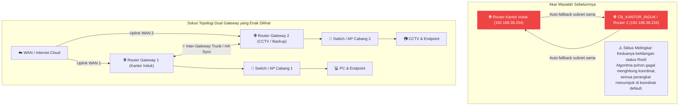

# Rencana Implementasi: Penataan Topologi Dual Router Gateway & Inter-Router Connection

## Ringkasan Tujuan
Menyelesaikan masalah pada Peta Visual Dashboard ketika pengguna menambahkan 2 (atau lebih) Router Gateway:
1. **Mengatasi Router Tumpuk**: Memperbaiki logika `getDeviceParent()` agar perangkat berjenis `Router` atau `Gateway` tidak saling menganggap satu sama lain sebagai parent (mencegah siklus melingkar `Router A <-> Router B` yang menyebabkan hilangnya root pohon dan penumpukan koordinat).
2. **Menghubungkan Router Gateway ("Tersambung & Enak Dilihat")**:
   - Menghadirkan simpul hulu **☁️ Internet / WAN Cloud** di bagian atas canvas yang menghubungkan seluruh Router Gateway aktif secara simetris.
   - Menambahkan **Garis Penghubung Antar-Router (Inter-Router / HA Trunk Link)** dengan indikator redundancy/sync rute antar gateway (`Router 1 <··· HA Trunk ···> Router 2`).
3. **Penyusunan Pohon Simetris & Seimbang**: Algoritma auto-layout pohon multi-root dengan margin proporsional sehingga cabang di bawah Router 1 dan cabang di bawah Router 2 tidak saling bertubrukan dan tertata sangat rapi.

---

## Analisis Akar Masalah



### 1. Kenapa Router Saling Menumpuk?
Pada kode [src/pages/dashboard.js](file:///d:/Projek/WEB/Monitoring-Devices/src/pages/dashboard.js):
```javascript
function getDeviceParent(d) {
  // ...
  const sameSubnetParent = mockDevices.find((p) =>
    p.id !== d.id &&
    ['switch', 'router', 'gateway', 'hub'].some((k) => String(p.jenis || '').toLowerCase().includes(k)) &&
    getSubnetPrefix(p.ip) === devSubnet
  );
  if (sameSubnetParent) return sameSubnetParent;
}
```
Ketika ada 2 router di subnet yang sama (misal `192.168.38.254` dan `192.168.38.234`), Router 1 menunjuk Router 2, dan Router 2 menunjuk Router 1. Terjadi **siklus melingkar (circular dependency)** sehingga keduanya tidak pernah masuk ke daftar `roots`. Akibatnya koordinat hierarki gagal dihitung dan semua perangkat menumpuk di koordinat default.

### 2. Kenapa Tidak Tersambung?
Di dunia nyata, dua router gateway berdiri berdampingan sebagai pintu gerbang jaringan. Jika keduanya tidak memiliki simpul induk bersama, keduanya tampil sebagai 2 pohon terpisah yang mengambang di udara tanpa keterkaitan logis.

---

## Usulan Solusi & Rencana Perubahan

### Komponen 1: Perbaikan Logika Root & Deteksi Siklus ([src/pages/dashboard.js](file:///d:/Projek/WEB/Monitoring-Devices/src/pages/dashboard.js))
1. **Router / Gateway Otomatis Menjadi Root**:
   - Jika suatu perangkat berjenis `Router` atau `Gateway` dan pengguna tidak secara eksplisit memilih parent (`!d.parent_id`), perangkat tersebut **wajib dianggap sebagai Root Gateway** (tidak boleh otomatis mencari router lain di subnet yang sama).
2. **Pencegahan Siklus Graf (Cycle Breaker Guard)**:
   - Tambahkan fungsi pemeriksa leluhur `isAncestorOf(potentialParentId, currentDeviceId)` sehingga tidak ada perangkat yang bisa menjadi anak dari cucu/cabangnya sendiri.

### Komponen 2: Simpul Visual "☁️ WAN / Internet Cloud"
1. **Rendering WAN Cloud Otomatis**:
   - Jika terdapat 1 atau lebih Router Gateway di jaringan, canvas menggambar simpul hulu elegan di tingkat paling atas:
     - Label: `☁️ Internet / WAN Backbone`
     - Status: Mengikuti status router (jika minimal 1 router online, WAN online).
   - Menghubungkan WAN Cloud ke masing-masing Router Gateway dengan garis kurva bercahaya (`#0284c7` dengan partikel paket data).
2. **Garis Penghubung Antar-Router (Inter-Router Trunk)**:
   - Jika terdapat 2 atau lebih Router Gateway (misal Router Kantor & Router CCTV, atau Dual WAN ISP), gambar garis trunk horizontal antar-router dengan label badge `⚡ HA / Trunk Sync`.
   - Ini membuat topologi terlihat profesional, menyatu, dan mencerminkan arsitektur jaringan enterprise / NOC sesungguhnya.

### Komponen 3: Penataan Layout Seimbang (Multi-Root Balance)
1. **Pemisahan Cabang yang Proporsional**:
   - Hitung total rentang subtree Router 1 dan Router 2.
   - Posisikan kedua router secara simetris di kiri dan kanan sumbu tengah canvas dengan jarak horizontal yang nyaman (`min 80px`).
   - Seluruh endpoint anak (AP, Switch, PC, CCTV) akan mengakar lurus ke bawah di bawah routernya masing-masing tanpa tumpang-tindih.

---

## File yang Akan Diubah

| File | Komponen | Perubahan |
|---|---|---|
| [src/pages/dashboard.js](file:///d:/Projek/WEB/Monitoring-Devices/src/pages/dashboard.js) | Frontend Topology Engine | Router guard di `getDeviceParent`, cycle breaker, simpul WAN Cloud, link inter-router trunk, dan auto-layout multi-gateway |
| [src/styles/layout.css](file:///d:/Projek/WEB/Monitoring-Devices/src/styles/layout.css) | Styling | Legend WAN Cloud & styling badge inter-router trunk |

---

## Rencana Verifikasi

### 1. Uji Dual Router Gateway di Database
- Simulasikan kondisi dengan 2 router gateway di level teratas (contoh: `Router Kantor Induk` dan `Router CCTV` sama-sama memiliki `parent_id: null`).
- Buka dashboard di tab **Peta Visual** (`http://localhost:3000/#/dashboard`).
- Pastikan:
  - Kedua router tidak menumpuk, melainkan berjajar rapi dan simetris di baris atas.
  - Terdapat simpul `☁️ Internet / WAN Backbone` di atas kedua router yang menghubungkan keduanya.
  - Terdapat garis trunk antar-router (`HA / Trunk Sync`) yang menghubungkan kedua gateway.
  - Endpoint anak mengakar ke bawah di bawah router masing-masing.

### 2. Uji Interaktivitas Canvas
- Uji tombol **🎯 Fit Screen**, **↺ Reset**, dan **📐 Tata Ulang**.
- Uji drag & drop salah satu router: garis penghubung WAN dan trunk tetap tersambung mulus.

---

> [!NOTE]
> Setelah rencana ini disetujui, perubahan kode akan segera diterapkan dan divalidasi langsung di browser.
